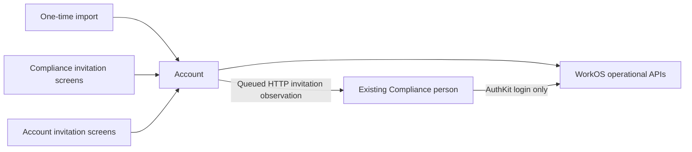

# Approval summary — Account-owned invitations

Status: proposal for owner approval. Implementation has not started.

## Result being approved

1. Run the initial import even while Compliance is old/offline: Account reads WorkOS, records people/invitations and a declared Compliance association locally, without calling or changing Compliance.
2. Account owns operational WorkOS communication. Existing Compliance screens continue to initiate work through Account; direct AuthKit login remains in Compliance.
3. Synchronize invitation status from either product, using durable HTTP and queues. Preserve existing users, access, permissions and training evidence. No events or new messaging infrastructure.
4. Authenticate products as systems without credential company UUID lists. Company identity/mapping and current human permissions remain enforced for every operation.

The last arrow represents the Compliance application's login flow, not an invitation job. Initial import has no Account→Compliance arrow.

## Important approval choices

- **Imported association is not remote confirmation.** The owner asserts existing WorkOS people belong to Compliance; local migration provenance records this without inventing product-local person IDs or receipts. Prior explicit denials are preserved.
- **Existing people require exact mapping.** Stable WorkOS identity plus company binding (or exact invitation identity) links records whose local IDs differ. Email alone never merges identities. Mapping does not create a new Compliance person or change their access/history.
- **Observation and delivery are different outcomes.** A successful WorkOS status read remains successful even if delivery to Compliance fails. The separate delivery target is visible/retryable. Status sync never sends mail.
- **Old unfinished work stays evidence.** The new local import never replays old remote-import work. The cutover handles old jobs explicitly and prevents any direct-provider fallback after deployment.

## Documents and approval boundary

spec.md is the rule source; scenarios.md contains23 concrete scenario/test proposals; plan.md orders implementation; architecture.md and contracts/ define exact boundaries. architecture-paths.json freezes the two repository file inventories. Execution contracts bind acceptance criteria, invariants, QA matrix and architecture hash. Owner approval of the listed hashes/scope is required before implementation; preparation authorization alone does not permit source changes.

## Verification and rollout limits

The architecture author examines implementation readiness, not the implemented product. All new feature tests/QA are NOT_RUN. Private paired-service/queue/cutover fixtures and final readiness checks remain required before Worker dispatch. No production credentials or secret values are requested, no production commands have run, no current access has been changed. Events, SDK extraction, training-domain changes and production deployment are outside this approval.
