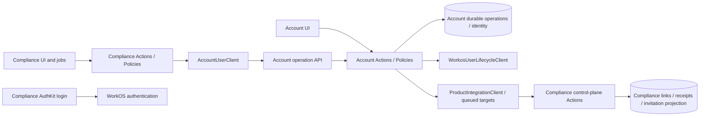

# Architecture: Account-owned invitations

Draft for product-owner approval · 2026-10-20 · scope `account-owned-invitations-v1` · author readiness **APPROVED_WITH_CONDITIONS**. This verdict means the proposal is implementable; owner approval remains **PENDING**. No implementation or deployment is authorized.

## 1. Context, references and decision scope

Read together with `spec.md`, `clarification.md`, `plan.md`, `scenarios.md`, `discovery.md`, `design-constraints.md` and the draft execution contract in `.toscanini/runtime/runs/20261020-account-owned-invitations/`. Rules are FR-001–015, AC-01–05, INV-01–05 and SC-01–23; these artifacts own the exhaustive behavioral examples. D-01–05 are confirmed decisions. P-01–04 and the concrete representations below are proposals submitted for approval, not historical owner decisions.

Targets: Account `/Users/andrepiresdemello/Code/Oceanix/Account` and Compliance `/Users/andrepiresdemello/Code/oceanix-api`. Separate databases, local identities, permissions and releases remain. Training, historical access repair, production deployment, SDK extraction, events and new dashboards are out of scope. Nothing deletes operational evidence. The two products are integration peers, not shared-database modules or architectural templates for one another.

| Convention / decision | Inspected evidence | Classification | Purpose |
| --- | --- | --- | --- |
| Thin UI, Actions for writes, Services for reads/external HTTP | Both `AGENTS.md`; Account `app/Actions/CompanyUsers/SendCompanyInvitation.php`; Compliance `app/Actions/People/RegisterPerson.php` | Existing | Preserve framework-native implementation |
| Durable identities, targets, immutable intent and receipts | Account `app/Models/AccessTransition.php`, `AccessTransitionTarget.php`, `ProductPersonLink.php`; Compliance `AccountRequestOperation.php`, `ProductOperationReceipt.php` | Existing | Reuse recovery machinery without a broker |
| Import currently calls Compliance even in preview and replays old frozen items | Account `app/Actions/CompanyUsers/ImportWorkosPeople.php` | Observed behavior to replace, not product authority | INV-01 requires an independent local command |
| Linked/unlinked invitations currently take different provider paths | Compliance `app/Actions/People/SendWorkosInvitation.php`, `ReconcileWorkosInvitations.php` | Observed behavior to replace | Remove every operational fallback |
| Platform membership/invitation also calls WorkOS | Compliance `app/Actions/Platform/GrantPlatformCompanyAccess.php`, `InviteCompanyAdministrator.php` | Existing callers in D-02 scope | Route through Account; preserve platform authorization |
| Mapping-only and observation-only operation kinds | Sections 7.2–7.5 | New feature-local contract | Cannot reuse access-changing provisioning/adoption for status work |
| Declared association provenance and independent observation sequence | Section 7.1 | New feature-local persistence | Do not fabricate remote access or reuse access version counters |

### Framework suitability and reference assessment

Actual installed `vendor/composer/installed.json` in **each** repository reports Laravel **13.26.1**, Livewire **4.4.1**, Sanctum **4.3.3**. Both project instructions and both control-center design-system documents were consulted. No `laravel/boost` entry exists in either installed package list and no Boost documentation tool is exposed. Boost policy is optional; no Boost call or installation is claimed.

| Target | Sources actually consulted | Reference purpose / accepted and rejected patterns | Native option / tradeoff / assessment |
| --- | --- | --- | --- |
| Account / Laravel 13.26.1 | Its `AGENTS.md`, `docs/control-center-design-system.md`; installed Toscanini adapter `/Users/andrepiresdemello/Code/toscanini/templates/adapters/laravel.json`; workflow `references/installation.md` and `execution-readiness.md`; official Laravel 13 HTTP client, queues, Sanctum below | Compliance is evidence of wire compatibility and existing user identity only. Accept envelope/receipt interoperability, reject shared training models or copying Compliance layers | Eloquent Actions, focused lifecycle client, durable jobs and Sanctum principal. No repository wrappers, package extraction or framework conflict. **aligned** |
| Compliance / Laravel 13.26.1 | Its `AGENTS.md`, `docs/control-center-design-system.md`; same installed adapter/readiness guidance and official Laravel 13 sources | Account is the authority for operational provider ownership, not local roles/training. Retain independent Policy/TenantContext boundaries; reject treating Account enabled flags as permission to rewrite local history | Existing People Actions plus AccountUserClient and operation receipts. Extra mapping/observation Actions isolate narrower side effects than provisioning. **aligned** |

Official sources consulted on 2026-10-20: [Laravel 13 HTTP client](https://laravel.com/docs/13.x/http-client) for explicit deadlines/status handling and fakes; [Laravel 13 queues](https://laravel.com/docs/13.x/queues) for after-commit dispatch, retries and failed execution; [Laravel 13 Sanctum](https://laravel.com/docs/13.x/sanctum) for API token authentication and authorization distinction. These support the selected mechanisms; they do not mandate our Action naming or durable-operation design. No external reference project was supplied. Both targets are affected implementations, not references to copy mechanically. The orchestrator must copy these two assessments to `architecture.frameworkAlignment`; architect ownership excludes editing the contract.

Testing strategy is separate from layering: follow the plan's regression-sensitive Pest approach, demonstrating failure before the fix where feasible and recording equivalent defect sensitivity otherwise. No extra TDD product decision is needed for this preparation.

## 2. Architectural style

Use the existing Laravel modular application style: presentation → single-purpose Actions → Eloquent and focused HTTP clients. Projection Services supply existing screens. Queued jobs execute persisted operation IDs, never serialized business decisions. Durable operation/target rows are the dispatch ledger. A scheduled recovery dispatcher closes commit-before-enqueue and crashed-worker gaps. HTTP snapshots are application commands, not an event platform.

This is sufficient because only two product boundaries and one provider exist. Additional repositories, generic sync abstractions, domain-event buses and a shared SDK add no required safety. Preserve the existing durable transition machinery; extend its dispatcher for the new kinds rather than duplicating retry state.

## 3. Directory and module structure

The exact candidate mutation boundary is `architecture-paths.json` (per-repository, existing/new paths). Read-only dependencies outside that list are context, not additional review scope. A required new path outside the frozen list needs an explicit amendment before implementation.

**Account** (feature-local additions, existing directories):

```text
app/Actions/CompanyUsers/
  ImportWorkosPeople.php                 # extend: local baseline only
  MapExistingProductPerson.php           # new: exact existing imported-person mapping
  QueueCompanyInvitationSync.php         # new: per-person durable work reservation
  ReconcileCompanyInvitation.php         # new: provider read and snapshot reservation
  SyncCompanyInvitations.php             # extend: thin queue-oriented facade
  SendCompanyInvitation.php              # extend: send only; observation target on success
  EnsureProductPersonMembership.php      # new: existing platform membership semantics
app/Actions/Integration/AuthorizeAccountOperator.php    # new: live holding authority
app/Http/Controllers/Integration/AccountActorAuthorizationController.php
app/Http/Requests/Integration/AccountActorAuthorizationRequest.php
app/Services/CompanyUsers/AccessTransitionProcessor.php
app/Services/Products/{ProductIntegrationClient,ProductRegistry}.php
app/Services/Integration/ProductActorAuthorization.php
app/Models/{CompanyProduct,UserProductEntitlement,WorkosPeopleImportItem}.php
app/Models/{CompanyMember,CompanyInvitationObservation,AccessTransitionTarget}.php
app/Jobs/ProcessAccessTransition.php
app/Console/Commands/RecoverInvitationOperations.php   # new: bounded due recovery
app/Data/ProductOperationEnvelope.php
app/Http/{Controllers,Requests,Resources}/Integration/ # extend existing operation boundary
resources/views/components/{company-users,companies,communications}/
database/migrations/2026_10_20_000001_add_account_invitation_ownership.php
```

**Compliance** (feature-local additions, existing directories):

```text
app/Actions/People/{AdoptPeopleIntoAccount,SendWorkosInvitation,ReconcileWorkosInvitations}.php
app/Actions/People/RegisterPerson.php                  # preserve confirmed-first ownership
app/Actions/Platform/{GrantPlatformCompanyAccess,InviteCompanyAdministrator}.php
app/Actions/ControlPlane/{ApplyProductOperation,AuthorizeProductActor,EnsureCompany}.php
app/Actions/ControlPlane/MapExistingAccountPerson.php   # new: mapping without provisioning
app/Actions/ControlPlane/ApplyInvitationObservation.php # new: status without access
app/Services/Account/{AccountUserClient,AccountActorAssertion}.php
app/Services/People/PeopleDirectory.php
app/Data/AccountInvitationObservation.php              # new: validated snapshot value
app/Models/{PersonAccountLink,User,AccountRequestOperation}.php
app/Jobs/{SendWorkosInvitation,ReconcileWorkosInvitations}.php
app/Console/Commands/QuarantineLegacyInvitationWork.php # new: no external dispatch
app/Http/{Requests,Resources}/ControlPlane/             # extend existing operation boundary
resources/views/components/organization/⚡people.blade.php
database/migrations/2026_10_20_000001_add_account_invitation_projection.php
```

Old names mentioning Workos can remain compatibility entry points for persisted job classes; they must delegate to Account and cannot retain provider imports. No broad rename is required. The exact existing job payload signatures remain readable across deployment.

## 4. Class responsibilities and non-use

| Type | Account responsibility | Compliance responsibility / deliberate non-use |
| --- | --- | --- |
| Livewire | Existing company-users/companies/communications components validate, authorize, dispatch and render projections | Existing people/import components do the same; platform components retain existing entry Actions. No provider or business-query logic in views |
| Controller | Existing invokable `ProductUserOperationController`, status and registration mapping controllers route validated kinds | Existing invokable control-plane operation/status/actor controllers route mapping and observation branches; no extra REST controller layer |
| Form Request | `ProductUserOperationRequest` validates strict kind-specific shape and header/path identity | `ProductOperationRequest` validates observation/map shape separately from `enabled` payloads; actor request updated for allowed kinds |
| API Resource | `OperationResource` serializes canonical operation and per-target state | `ProductOperationResource` serializes exact stored receipt, never a model dump |
| Action | Names in §3 each own one side effect; `ReconcileCompanyInvitation` never sends | `MapExistingAccountPerson` only links; `ApplyInvitationObservation` only projects; old People Actions orchestrate durable Account requests |
| Service / external client | `WorkosUserLifecycleClient` is provider boundary; `ProductIntegrationClient` product HTTP; `CompanyUserDirectory`/`CommunicationDirectory` reads | `AccountUserClient` sole operational external client. SocialLogin AuthKit client remains login-only |
| Repository | None: no alternative persistence or needed abstraction | None; Eloquent directly in Actions and read Services |
| Query Object | None: directory Services already own reusable projections | None; `PeopleDirectory` remains reusable read projection |
| DTO / value | Existing `ProductOperationEnvelope` validates wire intent; immutable snapshot payload persisted on target | New readonly `AccountInvitationObservation` validates state, IDs, timestamps, generation/sequence; existing invitation snapshot retained only for local presentation compatibility |
| Model / persistence | Existing named Eloquent records extended with provenance/ordering; no generic sync entity | `PersonAccountLink`, `ProductOperationReceipt`, `User` retain local IDs; no copy of SharedPerson into Compliance |
| Policy / authorization | Company/CompanyMember Policies and `CompanyAccess`; integration actor verifier for product origins | Existing Permission/Gates/UserPolicy, `PlatformAccess` for platform operations, `AuthorizeProductActor` for live proof; TenantContext always restored |
| Job / command | Existing ProcessAccessTransition, new due-recovery command; import remains explicit console operation | Existing jobs preserved as adapters; quarantine command records legacy disposition without calls |
| Event / listener | None; no domain/application event dispatch for integration | None; HTTP/queues per D-03 |

## 5. Invocation, naming and query placement

New Actions expose `handle(...)`; commands and jobs delegate to it. Existing `SendWorkosInvitation::execute` and `SendCompanyInvitation::resume/fromProduct` remain compatibility methods and delegate only to bounded persisted work. Controllers remain invokable. Persistence models retain singular entity names. No Helper/Manager/Utils or generic synchronization Service.

Eloquent queries belong in transaction-owning Actions, durable-operation processor/dispatcher, Models' relationships/scopes and existing projection/authorization Services. HTTP clients validate transport and serialize payloads but do not query domain tables. Queries are forbidden in Blade templates, component business methods, DTOs, API resources and new controllers (existing receipt lookup should move to the owning Action when touched). Actions query directly; no method-for-method Eloquent wrappers. Explicit unscoped Compliance user reads require company predicates and temporary TenantContext for the actual bound company. Queries by email can detect collisions, never establish identity.

## 6. Dependency direction



Forbidden: Compliance operational Actions/jobs/platform flows → WorkOS; Account import → any product client/registry; mapping/observation → provisioning/access Actions; UI → provider/client directly; Account → Compliance database; cross-product Models/imports. Existing AuthKit authentication/token refresh is the sole Compliance provider exception (INV-02). Do not import Services/Workos into operational callers, even behind an error fallback.

## 7. Cross-cutting ownership and system contracts

### 7.1 Persistence, ownership and initial migration (P-01, P-04)

Account owns identity, company membership and invitation observations; Compliance owns local authorization and training. Add nullable `association_source`, `association_declared_at` and `association_provenance` to existing Account CompanyProduct and UserProductEntitlement. Values for this import are `legacy-workos-import` plus the local import record ID and D-01 declaration reference. Association does not require remote IDs, product token, product module connection or enabled confirmation. UI may list a declared product as **Imported association · not verified** so it does not misleadingly say “No available products”. It cannot label it Enabled or make operational grant controls succeed without an actual binding. Preserve explicit enabled/disabled state and pending access transitions; a declared baseline never wins over an explicit denial. A new declared association leaves remote confirmed state unknown/false and remote local ID null. Do not use the existing `CompanyProduct::creating` enabled→confirmed hook to manufacture a confirmation.

Local company member baseline may be active only from active exact-organization WorkOS membership; pending/inactive/absent evidence yields no active access. Record invitation-only people and all four recognized invitation states independently of accepted identity. Their existence/association does not grant product access. Unknown states, bad IDs, contradictory organization or multiple identity matches are conflicts. Fetch all company pages before applying that company's new rows so failed pagination cannot look like a complete import; use short per-person transactions, idempotent source keys and explicit partial result if later persistence fails. Preview performs no writes, including diagnostics tables; safe console diagnostics are allowed.

Keep old WorkosPeopleImportItem input/hash/operation IDs/receipts immutable. Add separate local-baseline fields (`local_baseline_version`, `local_imported_at`, `local_import_outcome`, `legacy_dispatch_disposition`) rather than altering old intent. Prior confirmed remote receipts remain confirmed history; prior pending/unknown/dispatched rows remain unresolved remote evidence and are marked quarantined for legacy dispatch. New local baseline uses the same exact source identity with independent local outcome. The new command neither resolves unknown remote outcomes nor obtains remote receipts. Repeat apply never replays the migration client, even when a source vanished. Legacy recovery is mapping-only later, not replay of migration provisioning. No silent remote rollback or deletion (AC-01; SC-01–06).

Add independent Account member `invitation_observation_sequence` (default 0). Extend CompanyInvitationObservation with generation, sequence, safe error and last successful verification. Add Compliance `invitation_observation_sequence` default 0 to User. This counter is not an access version and never changes permissions. Persist snapshot payload/hash on AccessTransitionTarget when creating a delivery target; extend its immutability protection for these fields. Existing immutable confirmed operation rows are never reopened to attach targets: new projection work is either reserved before parent confirmation or a new related transition referencing the original observation.

### 7.2 Wire contracts and exact mapping (P-02)

Retain protocol envelope v2 and current routes. New kinds are additive and fail 422 on old releases; readiness/cutover prevents enabling new operational dispatch until both versions are installed. Every PUT requires route ID = operation UUID = Idempotency-Key. Canonical hashes exclude only renewable actor proof and retain all business fields. Existing receipt identity fields and strict validators remain; add only kind-specific `confirmed_state` fields. Do not add `enabled` to mapping or observation payloads merely to satisfy the old request validator.

| Direction / kind / endpoint | Payload and result |
| --- | --- |
| Compliance→Account `person.map-existing`, PUT `/api/product-access/v1/operations/{uuid}` | Exact company UUID+org, local person ID, WorkOS user ID or invitation ID, asserted current invitation generation and mapping source. Result contains shared_person_id, company_member_id, local_person_id and mapping_complete; no access fields |
| Account→Compliance `person.map-existing`, PUT `/api/control-plane/v2/operations/{uuid}` | Exact Account shared/member IDs and provider identity; optional existing local person ID only as an additional cross-check. Result identifies the existing local person and exact IDs. Account persists ProductPersonLink after validating receipt |
| Either UI→Account `person.invitation.reconcile` | Known mapped subject, exact current invitation ID/generation; Account reserves a provider-read target and later delivery target. No population enumeration |
| Account→Compliance `person.invitation.observed`, PUT existing control-plane v2 route | §7.3 snapshot; durable result `applied` or `superseded` with accepted generation/sequence, exact local person and Account member IDs |
| Existing `person.invite` and confirmed-first `person.register` | Retain explicit send/registration intent and existing idempotency semantics; snapshot delivery uses a different target ID |

Mapping resolves the company binding first. On receiver side query exact company plus unique provider user ID; when absent, query exact company plus invitation ID for an invitation-only person. Account uses SharedPerson+CompanyMember for the first case and existing CompanyMember invitation for the second; Compliance uses existing User. If both IDs are supplied they must resolve to the same person, or the invitation must prove that accepted identity without conflicting existing link. Require one candidate. Zero/multiple/conflicting candidates → explicit `mapping_required`/`identity_conflict` (409), safe per-person recovery; never create a person, merge by email or overwrite an immutable mapping. Imported Account rows are deliberately reused. No need for Compliance local IDs to equal Account UUIDs.

Both origins automatically run a distinct mapping-only HTTP operation as the first-use prerequisite of the existing sync/send intent when links are missing. This is explicit protocol work, not an extra manual migration or new screen. The operation inherits only the initiating current sync/invite ability for its exact subject and has no access side effect; separately requested adoption/import retains existing manage/import permission. Account-origin mapping schedules the mapping request to Compliance; Compliance-origin mapping supplies its local ID. Only missing or conflicting exact evidence requires operator intervention in the existing per-person recovery surface. The receiver commits mapping plus receipt atomically; sender persists its reciprocal link from the validated receipt. Lost response retries the same UUID/hash and returns the same receipt. Half-linked state remains mapping-pending; observation cannot proceed until both sides acknowledge the exact pair. Mapping never initializes/modifies entitlement, PersonProductAccess, local roles, status, assignments, certificates or evidence. The older `person.adopt` creation/access behavior is not used for this flow; existing adoption UI/command routes existing legacy people through mapping-only, while old receipts remain readable.

### 7.3 Observation and ordering (P-03)

Payload contains `local_person_id`, `shared_person_id`, `company_member_id`, provider user ID if known, invitation `{id,state,created_at,expires_at,accepted_at,revoked_at,accepted_user_id}`, `generation`, `observation_sequence`, `verified_at`, `accepted_history_at` and optional membership evidence explicitly marked informational. State is pending/accepted/expired/revoked or none (id null for confirmed absence). All timestamps validate before persistence; verified_at is Account's successful read clock, never substituted with product receive time. Provider failure is an error, never a none snapshot. Read an exact existing invitation or identity-bound invitation evidence only; do not download arbitrary company people. A valid accepted_user_id is not restricted to accepted state. Bind it only without identity conflict; do not infer active access from it.

Reserve a single active reconcile per company/member/current generation under locks; concurrent requests return the already open operation and its state. Claim lease 120 seconds; job timeout 60; queue retry_after must exceed 120. Snapshot provider-read occurs outside locks. On apply lock company→member→operation/target, check lease token, current company/invitation generation/ID and current actor authority; stale generation finishes as superseded without overwriting. Increment sequence only for a successful accepted Account observation; freeze the resulting snapshot on a new delivery target in the same transaction. Last-successful state/time remains intact on failures; separate safe error/attempt metadata describes failure.

Compliance verifies service principal, binding, exact reciprocal link and snapshot identity. Under company→User→receipt locks: duplicate UUID/hash returns prior receipt; different hash returns 409. Compare `(generation, observation_sequence)`. Lower pair is acknowledged superseded, preserving its receipt; equal pair requires same snapshot content, otherwise conflict; higher pair applies only if it refers to the current invitation or a newer Account generation with exact mapping. A higher sequence cannot make an old generation current. Advance accepted history by max timestamp; never erase accepted history on expired/revoked/current none. Update only invitation fields/verification metadata and sequence. Do not update workos_active_membership, local status, access, roles or training. Existing access version is untouched. Store receipt and projection in one transaction. The same projection Action handles a validated Compliance-origin returned snapshot so delayed push and response races use identical ordering guards.

### 7.4 Durable work, timeouts, retry and recovery

Use existing AccessTransition/Target, ProcessAccessTransition and CommunicationDirectory. Account-origin batch action reserves one transition per known member, including honest no-invitation outcomes; no parent bulk success conceals per-person failures. `ReconcileCompanyInvitation` performs only provider GETs. `SendCompanyInvitation` owns sends and cannot be selected by reconcile kind. Dispatch after commit; due recovery command runs each minute, claims due records atomically and re-enqueues IDs. A lost enqueue remains in the ledger. Delivery target `compliance.invitation` uses a new immutable target UUID, exact envelope/hash and independent attempts from `workos.invitation.read`. A successful provider target is immutable and never re-run because delivery failed. Communication status distinguishes observed success, delivery pending/failed and mapping required. Parent completes only when required targets have valid receipts; partial remains visible. Imported but unmapped people show mapping-required rather than a fabricated delivered result.

Retain explicit HTTP connectTimeout(3), timeout(15), no redirects, trusted configured HTTPS URLs (loopback only in local/testing). No nested HTTP retry loops. Initial attempt plus at most six retries uses existing offsets `[60,300,900,3600,14400,43200]` seconds from retry_started_at/creation; after the seventh failed attempt set needs_attention and next_attempt_at null. Transport/429/5xx/malformed or mismatched receipts are unresolved; 401/403/configuration/404-old-release/mapping conflict are actionable needs_attention without automatic hammering. No worker restart is needed for recovery. A GET receipt after ambiguous PUT occurs before resubmission; 404 permits same immutable PUT, not a fresh intent. Same-intent resubmission is safe because receiver deduplication is atomic. Manual retry requires current same-operation ability and retry ability; it resets failed target scheduling only, records retry audit, retains UUID/hash/dispatched flags and confirmed targets. Original initiating actor is rechecked; a different authorized operator cannot impersonate a revoked actor. Cancelled/denied work needs a fresh explicit authorized intent after outcome resolution.

For provider mutation ambiguous outcomes preserve dispatched_at and refuse blind resend/recreate. Read exact known identity/invitation for recovery; when it cannot prove the effect, expose delivery-unconfirmed for operator resolution. Manual retry does not clear the mutation marker. Status-only retry can never mint invitation email. Concurrency checks use PostgreSQL integration evidence, not SQLite lock assumptions (AC-03; SC-16–19).

### 7.5 System principals, company binding and actor authority

Remove company_uuids authorization checks at **all** affected middleware/Actions/receipt/actor endpoints in both products, not just token creation. Retain columns as deprecated compatibility data; empty, populated and obsolete values have no authorization meaning. Do not reinterpret empty as wildcard. Setup creates system credentials with no company selector; keep active/expiry/Sanctum token expiry/environment/product/module identity checks. Account→Compliance retains its existing absence of per-capability checks. Compliance→Account retains principal and token operation capabilities, adding exact new kinds only where needed. A token is a system identity, never human authority.

For known companies require Account UUID + WorkOS organization + stored Compliance company binding equality. Receipt reads bind to original principal, operation company and current binding, never UUID allowlist. `company.provision` can establish a new binding only through the configured Account system identity and a verified Account holding-operator assertion; reject collisions on UUID, org or existing company mapping. Add `AuthorizeAccountOperator`, invokable `AccountActorAuthorizationController` and `AccountActorAuthorizationRequest` at POST `/api/product-access/v1/actor-authorizations` for Account-origin company provisioning, with signature/hash/time/nonce and live current holding privilege; Compliance calls it before provisioning and verifies its response. Product module registration is trusted operator configuration; callers cannot choose arbitrary URLs. No per-company credential reissue.

Product-origin user work retains existing 60-second signed proof of operation/hash/actor/company/product/kind/subject, nonce cache and fresh authorization callback on each execution. Compliance authorizer confirms current persisted person permission, prerequisites, local target/company and original durable intent; `person.map-existing` includes immutable `source_operation_id` and `source_kind` for the existing invite/reconcile intent and verifies its exact subject, actor and required current ability, rather than accepting an arbitrary claimed source; Account independently validates the actual company/member identity. Revocation blocks pending work. Account-origin requests check current Account User/CompanyMember Policy at reservation and each execution, including before snapshot projection delivery. For Account-origin automatic mapping, the receiver obtains a fresh Account operator proof bound to company/member/source intent using the same configured-system authorization endpoint; `AuthorizeAccountOperator` checks the source invite/reconcile Policy, whereas company provisioning checks holding privilege. A signed proof of mapping is never an access grant. Credentials alone cannot initiate a person operation. A stored immutable successful receipt may be returned after current service authentication even if the original human's grant changed; it is evidence of a past effect, not authority for a new effect.

Platform flows need an explicit actor discriminator because a Compliance `Account` platform administrator is not necessarily a tenant User. Preserve `PlatformAccess::authorize()`; persist `actor_context=platform-account` and originating account ID in the immutable operation payload, with stable WorkOS actor ID. Only the existing platform entry Actions can reserve `person.membership.ensure`/platform invitation intent. The fresh Compliance callback reloads active Account and platform privilege plus exact target company and stored operation/hash; Account accepts this narrowly verified platform authority, never a generic membership bypass. Existing-person ensure in Account uses exact provider user+org and existing membership recovery; no status-only path invokes it. Tenant invitation requests still require tenant permission. Preserve local admin-role behavior only in the existing platform write Actions after confirmed Account outcome; no role mutation in observation/mapping. This is the necessary D-02 routing change, not a new platform access model.

### 7.6 Ownership summary

| Concern | Owner / boundary |
| --- | --- |
| Validation | Form Requests and typed envelopes at HTTP; Action validation for UI/commands; strict kind-specific payload allowlists |
| Authorization / tenant isolation | Current local Policies/Gates/PlatformAccess; authenticated system principal; exact Company/AccountCompanyBinding; fresh signed originating actor verification |
| Mapping | Mapping-only Actions; reciprocal immutable links; exact stable identity, not email |
| Transactions / locks | Owning Action/processor; short lock order company→member/User→operation/target/receipt; unique indexes remain final race protection; no network inside transaction |
| Persistence | Eloquent named records; immutable original intents/confirmed targets/receipts; local provenance does not rewrite history |
| External calls | Account lifecycle/product clients; Compliance AccountUserClient; login-only AuthKit exception |
| Error translation | Owning Action maps known failures to safe codes; clients validate every receipt identity; UI translates safe codes rather than raw provider payloads |
| Serialization | Envelope/DTO and API Resources; no secrets/raw model attributes |
| Configuration | Existing services.account and ProductModule registry; system tokens, assertion secrets and operational cutover flag via normal secure operator setup, never committed values |
| Telemetry | Existing audit/communication projections; IDs, kind, outcome, attempts and duration only; no bearer tokens, assertion secrets or provider response dumps |
| Retries | Durable targets/processor and scheduled due recovery; job tries=1 to avoid duplicate retry engines |
| Migrations / rollback | Additive fields/indexes, retain old IDs and rows. Before unique constraints run scoped duplicate diagnostics and stop conflicting rows; no merge/delete. Rollback stops centralized dispatch; do not downgrade to direct-WorkOS operational code or drop evidence. Forward repair is required after new records exist |

### 7.7 Cutover and risk containment

Local-only import is independently deployable first, without a product connection. It never auto-maps or dispatches. Before enabling operational flow, install both compatible versions, configure synthetic/private verification first, establish company bindings and explicit mappings, add new inbound Account capabilities, verify queues/scheduler/leases and then enable the operational cutover flag. Default off for new protocol dispatch. Missing/old receiver leaves operational actions visibly unavailable; no WorkOS fallback.

Quarantine old queued invitation/sync payloads by persisted operation identity/version, retain their old class entry points, and mark old direct jobs as needs_attention without provider calls. Unsent verified new-format jobs can delegate through Account; already send_started/unknown legacy work requires status-only recovery or human resolution, never auto-send. Stop old workers before rollout and restart only new code. Preserve old import operation evidence separately (§7.1). Runbook must cover independent initial import, pair readiness, queue inventory/quarantine, mapping conflicts, exhausted targets and forward-only recovery. No production command is run during this preparation.

Main risks: half-linked identities, stale observations, lost post-commit enqueue, ambiguous email mutation, actor revocation and legacy job execution. Sections 7.2–7.7 specify prevention/recovery; these are not reasons to add another service or event infrastructure.

## 8. Concrete execution flows

1. **Initial preview/apply**: ImportWorkosPeople command → holding authorization → ImportWorkosPeople Action → WorkosUserLifecycleClient complete company pages → validate exact org/identity → read-only plan or local short transactions for SharedPerson/CompanyMember/declaration/import outcome. No product client is constructed or resolved. Old frozen remote work is displayed/quarantined, never dispatched (AC-01).
2. **Compliance unlinked existing person**: existing sync/invite control → automatic mapping-only prerequisite through AdoptPeopleIntoAccount → durable AccountRequestOperation `person.map-existing` → AccountUserClient + fresh actor proof → MapExistingProductPerson resolves imported rows → reciprocal receipt → Compliance MapExistingAccountPerson link finalization. Then QueueWorkosSynchronization → persisted reconcile intent → Account provider-read target → frozen snapshot → Compliance ApplyInvitationObservation. Existing User ID and training relationships stay fixed (AC-02).
3. **Account origin**: company-users sync → QueueCompanyInvitationSync reserves known members → ProcessAccessTransition → ReconcileCompanyInvitation → provider GET → observation+delivery target transaction → ProductIntegrationClient PUT → control-plane Form Request → ApplyInvitationObservation → receipt → confirmed delivery target. If unlinked, the automatic mapping-only prerequisite runs first; reconciliation waits for its acknowledgement and only conflicts require intervention (AC-02/03).
4. **Send/resend**: authorized UI or platform Action → persisted explicit invite request → Account SendCompanyInvitation → current actor verification → exact membership/invitation checks → one provider mutation at most until outcome resolved → same observation delivery machinery. A reconcile kind can never select this branch (INV-04).
5. **Failure/retry**: missed enqueue or due target → RecoverInvitationOperations → claim → prior receipt lookup → same intent PUT → stored receiver receipt. Exhaustion → CommunicationDirectory needs_attention → authorized retry same ID/hash; no repeated confirmed provider read/send just to repair product delivery (AC-03).
6. **New company**: Account company provisioning intent + live holding actor proof → Compliance EnsureCompany → establish exact binding and receipt without company-token list → later user operations use that binding and their own human ability (AC-04).

## 9. Test seams

Use Pest and existing global database fixtures. `Http::fake()` every WorkOS/product request with stray-request prevention; no real provider calls. Test real Form Request→middleware→Action→Eloquent→Resource boundaries for authentication, mapping and observation receipts. Fake only external HTTP, clock and queue dispatch when asserting reservation; run actual jobs/processor separately to prove durable work and failure transitions. Test no-call assertions with import product connection absent and direct WorkOS requests forbidden from Compliance operations. Login positive control remains direct AuthKit fake.

SQLite proves deterministic state/validation/idempotent replay; disposable PostgreSQL proves row-lock contention, unique identity reservation, lease ownership and out-of-order apply (SC-19). Paired local HTTP/worker fixture proves both origin deliveries, lost response after commit, receipt retrieval and unavailable/old receiver behavior. Browser evidence exercises only changed existing people/company-user/communication controls, narrow/wide layout, permitted/denied states and visible retry. Platform test seam covers existing grant/invite entry Actions through Account, with no provider HTTP from Compliance. SC-01–23 in scenarios.md own complete fixture/assertion and QA mapping; tests are planned, **NOT_RUN**. No second architecture reviewer is required.

## 10. Author verdict and classified conditions

Author readiness: **APPROVED_WITH_CONDITIONS**. No unresolved competing architectural choice remains after D-01–05; the complete proposal including P-01–04 is ready for the owner's explicit accept/reject decision. This does not convert pending approval into an accepted product decision.

| Condition | Category | Reference | Owner / next action | Material architecture uncertainty? |
| --- | --- | --- | --- | --- |
| Explicit acceptance of the submitted spec/P-01–04, architecture and frozen contract hash/scope | product-decision / approval gate | §11, AC-01–05 | Product owner; record actual decision | Approval pending; no hidden alternative selected |
| Paired private HTTP/queue/PostgreSQL harness, test/build dependencies and synthetic credentials not yet probed for this protocol | operational-dependency | SC-16–23 | Orchestrator finishes execution-readiness evidence before Worker | No; blocks execution, not document readiness |
| Exact additive migrations/routes/Actions/jobs/tests and secure setup | implementation-task | §§3–9 | One Worker after approval | No |
| Duplicate/conflicting production identity inventory and old queued-item inventory | spike | FR-005/009/015 | Operator uses read-only scoped diagnostics; conflicts remain explicit | No automatic repair; material new rule returns to owner |
| Per-repo frameworkAlignment and exact paths must be copied into draft contract | implementation-task (contract preparation) | §1, architecture-paths.json | Orchestrator before approval | No |

If the owner rejects a proposed representation or protocol, revise affected sections and rebind approval; do not mark an unresolved material alternative approved-with-conditions.

## 11. Product-owner approval

**PENDING.** Record explicit owner decision in execution-contract.json, bound to the SHA-256 of this file and scope `account-owned-invitations-v1`; also approve specification/clarification/plan and the frozen validation scope. Author verdict, document reading and framework alignment are not owner approval. Task generation and a single Worker follow approval and execution readiness, without another architecture-document review.

After stable implementation, deterministic checks, Code Review/Test Analyst and executable QA, perform one conformance check against this approved artifact and AC/INV IDs. Evidence is separate; do not change this architecture during conformance. Directed corrections retain original full-check evidence and name finding IDs plus impact reason.
