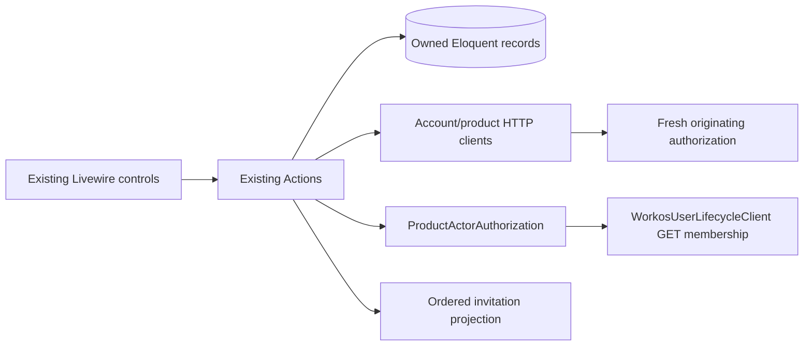

# Architecture: bounded invitation validation repair

## 1. Context, references and decision scope

Run `20261020-invitation-validation-repair`; scope `invitation-validation-repair-v1`. Authoring proposal, not owner approval. The prior run remains BLOCKED. This repair implements existing FR-007–014, AC-02–05, INV-02–05 and SC-09/11/15–19/23 in `specs/020-account-owned-invitations/spec.md`, `scenarios.md`, approved `architecture.md` §§7.2–7.5 and its clarification 01. `clarification.md`, `design-constraints.md`, `reviews/qa-report.md`, `reviews/design-review.md`, `replan-proposal.md` and this directory's plan/resume decision constrain this proposal. The six QA-R scenarios in the draft contract are the complete repair QA scope; this document does not enlarge it.

Source baselines: Account `8cb3a44f330c4675f11acf1ee3a6fbbde51ea6f2`; Compliance `462f6b5604268904393fa8aebee2bb771ca4beaf`. Current sources were inspected, including the named Actions/clients below. Runtime reports prove observed failures; their explanation of the missing Account login is not architectural authority. No credential-bearing raw runtime snapshot is reproduced.

This is an implementation repair against approved behavior, not a new product feature. No new Spec Kit specification/clarification is required: source authority without Account login, exact mapping, status-only preservation and visible verification age already appear in the approved artifacts. The minimal mapping receipt metadata described below is an implementation contract clarification submitted for explicit hash-bound approval. Decision risk is **low for unresolved product rules**, while implementation assurance remains **critical**: the owner already approved current human authority, exact active provider membership, no Account-login prerequisite, exact mapping and immutable ordering. This proposal implements those same rules through verified reads and guarded initialization; it neither chooses a new authorization policy nor introduces a new identity/access state. The pending architecture approval and QA evidence-substitution approval are real gates, not unresolved product behavior. Reclassify as material and reopen clarification if any of those rules must change; do not lower implementation assurance or claim readiness from this classification. Any decision to accept pending/inactive provider membership, merge identities, change access, or rewrite an existing request would change approved security/domain behavior and must return to clarification; none is proposed. Do not label missing approvals waived or fabricate a specification review to satisfy a verifier.

| Convention / decision | Evidence | Classification | Purpose |
| --- | --- | --- | --- |
| Thin Livewire, `handle` Actions, focused read projections | Both AGENTS.md; Account CompanyUserDirectory; Compliance ReconcileWorkosInvitations | Existing | Repair within current native Laravel design |
| Durable HTTP intents/receipts, company-first locks | QueueCompanyInvitationSync, AdoptPeopleIntoAccount, ApplyProductOperation | Existing | Preserve retry/order/identity contracts |
| Verify live exact provider membership for product actor after proof validation | Account ProductActorAuthorization and WorkosUserLifecycleClient::membership; approved §7.5 | New feature-local repair in existing class | Remove stale-cache denial without access activation |
| Mapping receipt exposes baseline pointer, without asserting verification | Account MapExistingProductPerson; Compliance AdoptPeopleIntoAccount | New feature-local additive receipt clarification | Initialize unknown generation-zero pointer before freezing reconcile |
| No Repository or generic orchestration layer | Actual Actions query Eloquent directly | Existing | No abstraction needed for two bounded repairs |

### Framework suitability and reference assessment

Both installed `vendor/composer/installed.json` files report Laravel **13.26.1**, Livewire **4.4.1**. Both AGENTS.md files and `docs/control-center-design-system.md` were consulted. Enabled adapters are Laravel, Spec Kit and terminal-ui; installed `.toscanini/manifest.json`, architecture skill and execution-readiness guidance were read, along with adapter definition `/Users/andrepiresdemello/Code/toscanini/templates/adapters/laravel.json` (Boost recommended). Neither installed package inventory contains `laravel/boost`; no Boost tool is exposed in the available-tool catalog and no installed Boost guidance was found. Boost consultation therefore used the official-documentation fallback, not a claimed Boost invocation.

| Target | Official / adapter guidance actually consulted | Reference purpose / assessment | Native choice and tradeoff | Alignment |
| --- | --- | --- | --- | --- |
| Compliance, Laravel 13.26.1 / Livewire 4.4.1 | Laravel 13 database transactions, HTTP client; Livewire 4 actions; installed Laravel adapter / project rules | Account is integration-contract evidence; prior approved architecture is behavior/security authority. Do not copy Account login/entitlement internals into Compliance | Existing Actions, Eloquent, typed receipt and thin components; one additive receipt field avoids a new discovery endpoint | aligned; no material framework conflict |
| Account, Laravel 13.26.1 / Livewire 4.4.1 | Same official pages and adapter; Account AGENTS/design system | Compliance proves originating permission and immutable intent; source product permission does not replace exact provider membership. No unrelated reference architecture imported | Existing ProductActorAuthorization, lifecycle HTTP client, mapping Action and directory projection; provider read adds latency but resolves stale cache safely | aligned; no material framework conflict |

Sources: https://laravel.com/framework/docs/13.x/database (transactions), https://laravel.com/framework/docs/13.x/http-client (timeouts/fakes), https://livewire.laravel.com/docs/4.x/actions (server authorization). These support native mechanisms, not a framework mandate for an Actions architecture. Compliance `composer.json` runs `tests/Browser/PeopleAccountAccessTest.php` in canonical verification; the comment-only `PeopleInvitationBrowserTest.php` is not an executable proof and is excluded from the repair inventory. Tests follow existing Pest conventions; demonstrate causal failing tests before fixes where feasible. TDD is a development strategy, not a new layer or unresolved product choice.

## 2. Architectural style

Retain the existing Laravel application architecture: Livewire presentation → use-case Actions / focused authorization and directory projections → Eloquent and bounded external clients. No enterprise layers, model repositories, generic services, new endpoints, event bus or SDK. Account owns provider operations; Compliance owns local operational permissions, people and training evidence.

Causal diagnosis: Account `ProductActorAuthorization::authorize` currently checks `confirmed_enabled`, cached `active_provider_membership`, verification timestamp and removal reservation before validating assertion signature. `EnsureProductPersonMembership` accepts a provider `pending` membership and persists `confirmed_enabled=true`, `active_provider_membership=false`. Acceptance outside Account can make the provider active while cache remains pending. For reconcile, Account User lookup is absent (it is limited to `person.register`); missing Account login itself is not the causal gate. Current provider state must be read safely after proof validation, rather than trusting either cache or login side effects.

The mapping failure is independent. `MapExistingProductPerson` returns only integration IDs. `AdoptPeopleIntoAccount` retains the existing local null invitation/generation zero; `ReconcileWorkosInvitations` then freezes that pair. Account `QueueCompanyInvitationSync::reserve` correctly rejects a different imported invitation at the same generation. Account-origin `MapExistingAccountPerson` also requires an exact invitation match even when exact provider user identity already resolves an untouched person. Neither strict ordering nor immutable intents should be weakened globally.

## 3. Directory and module structure

Exact candidate mutation paths are in `architecture-paths.json`; unused candidates confer no permission for unrelated changes. All files already exist in the original approved inventory/test amendments.

```text
Account/app/Services/Integration/ProductActorAuthorization.php
Account/app/Actions/CompanyUsers/MapExistingProductPerson.php
Account/app/Services/CompanyUsers/CompanyUserDirectory.php
Account/resources/views/components/company-users/⚡{index,show}.blade.php
Account/lang/pt_BR.json
Compliance/app/Actions/People/{AdoptPeopleIntoAccount,ReconcileWorkosInvitations}.php
Compliance/app/Actions/ControlPlane/{MapExistingAccountPerson,ApplyInvitationObservation}.php
Both/tests/Feature/... existing mapping, authorization and observation tests
Compliance/tests/Browser/PeopleAccountAccessTest.php (canonical executable browser entrypoint)
Account/tests/Browser/CompanyInvitationSyncTest.php
Account/tests/Support/{ProductIntegrationFixture,AccountOwnedInvitationFixture}.php
```

No new production class, route, migration or dependency is required. Existing provider/client/processor dependencies remain read-only unless explicitly listed in the inventory. All `.env`, Account `config/services.php` and Account verifier files are forbidden.

## 4. Class responsibilities and non-use

| Type | Responsible class/location | Deliberate non-use |
| --- | --- | --- |
| Livewire | Existing Account company-user list/detail; Compliance existing People controls | Render metadata, validate/authorize/delegate only; no provider or persistence business rules |
| Controller | Existing integration operation/authorization controllers | No new controller or route; keep existing invokable decisions |
| Form Request | Existing kind-specific requests | No new input fields or permissive payload expansion needed |
| API Resource | Existing OperationResource/ProductOperationResource | Serialize additive confirmed-state metadata through existing boundary; never raw models |
| Action | MapExistingProductPerson, AdoptPeopleIntoAccount, MapExistingAccountPerson, ApplyInvitationObservation, ReconcileWorkosInvitations | No access/grant Action invoked from sync or mapping |
| Service / external client | ProductActorAuthorization, WorkosUserLifecycleClient; AccountUserClient, ProductIntegrationClient; CompanyUserDirectory | No new Helper/Manager/Utils/Service wrapper |
| Repository / Query Object | None | Existing direct scoped Eloquent queries suffice |
| DTO / value object | ProductOperationEnvelope and AccountInvitationObservation | Preserve strict canonical input/hash and snapshot typing |
| Model | CompanyMember/SharedPerson/ProductPersonLink; User/PersonAccountLink/AccountRequestOperation; observation/transition records | Persistence names remain; no model rename or model observer side effects |
| Policy / authorization | Existing Policies/Gates; ProductActorAuthorization; fresh originating callback | Product proof is not Account UI authority; no new permission or bypass |
| Job / command | Existing ProcessAccessTransition/reconciliation jobs and recovery commands | No new queue engine or retry loop |
| Event / listener | None | No event infrastructure or invitation-sync access mutation |

## 5. Invocation, naming and query placement

Actions retain `handle`; existing focused `ensure`, `authorize`, `refresh` methods remain where already established. Eloquent queries stay in the owning Actions, ProductActorAuthorization, and CompanyUserDirectory read projection. Queries must include exact company/provider/link identity. Presentation may consume prepared observations but must not query provider, infer identity or write baseline. No HTTP in database transactions. No query wrappers around individual Eloquent calls.

## 6. Dependency direction



Compliance may call Account, never operational WorkOS. Account provider reads may not call membership mutation, entitlement or role Actions. Mapping/projection may not call user creation, registration, provisioning or access transitions. External clients do not choose arbitrary URLs or create domain records. Views may not import external clients or perform mapping decisions.

## 7. Cross-cutting ownership and system contracts

### 7.1 Current actor authorization repair (QA-R01/R06)

Within existing ProductActorAuthorization, validate principal active/expiry/environment/product/capability and registered module identity; resolve exact Company UUID + organization and current product binding. Validate assertion exact operation/actor/company/product/kind/subject/hash, timestamps, signature and nonce **before any provider request**. Preserve nonce consumption semantics; do not consume one nonce twice. A signed stale stored payload is not a fresh callback. Existing dispatch/worker paths still obtain a new originating proof and recheck before each effect.

For ordinary product actors in **every existing operation kind handled by this shared guard** (including `person.register`, mapping, invitation/reconcile, adoption and product access operations), resolve exactly one current CompanyMember by company + SharedPerson WorkOS actor ID. Retain `confirmed_enabled=true`, non-null provider verification evidence and no admin-removal reservation. Do not require cached `active_provider_membership=true` as the sole current decision. Read exact current membership through existing `membership(member.workos_membership_id, actor_workos_user_id, company.workos_organization_id)` after cryptographic validation; require non-null matching membership ID/user/org and `status=active`. Missing/foreign/ambiguous/inactive/pending/malformed/provider-unavailable fails closed with existing safe failure handling. Re-read local principal/company/member removal/enable/binding constraints after the network read before accepting authority; no network under locks. Retain existing narrowly bounded holding registration/platform behavior, never broaden it to sync. Use the same ordinary-actor rule across kinds; a newly accepted administrator must not gain synchronization while remaining incorrectly denied registration by the same stale cache. This changes only the shared current-membership evidence source, not any operation capability, source permission, access-write behavior or holding exception. Account-origin UI operations continue their existing Policies; they do not acquire this product-origin rule.

Do **not** persist active membership, confirmed access, provider timestamps, roles or entitlements during this authorization. This is a read-time authority decision. It neither creates an Account User nor requires Account login. Invalid proof must produce zero provider calls; denial/failure must produce zero invitation/access mutations. Existing source callback remains responsible for the current atomic permission, prerequisites, exact durable intent and revocation.

### 7.2 Mapping initialization repair (QA-R02/R03/R04)

Use an additive `confirmed_state.invitation_baseline = {invitation_id: string|null, generation: int}` on **new** Account `person.map-existing` receipts, captured under the same company/member lock as exact mapping. This is Account's known pointer, not a successful provider observation: it carries no state, verified time, accepted history or access claim. Preserve original receipts verbatim; clients tolerate absent metadata for historic receipt reads, but cannot invent initialization from absence. No input field, operation kind or new endpoint is added.

Compliance may initialize only an exact mapped person's **uninitialized** invitation baseline: null invitation ID, generation=0, sequence=0, null observation hash and null successful verification timestamp. Require exact current reciprocal IDs/company binding/provider identity and an explicit returned generation **0**. Initialize only invitation ID (and the equal zero generation); never status/history/verification/access fields. A nonnull existing pointer, any observation/hash/time, different provider identity, conflict or nonzero generation is not initialization: retain existing conflict/ordering behavior. Persist initialization under company→User→operation/link locks, rechecking preconditions after network return. A competing real observation wins; no stale metadata overwrites it.

`AdoptPeopleIntoAccount::ensure` must obtain this metadata before a **new** reconciliation request is frozen, including an already-linked but still-uninitialized person. Historical successful mapping receipts without metadata are immutable: if necessary reserve a distinct deterministic mapping-only source/request identity with a repair-version namespace, retaining source-intent proof, rather than changing its payload/receipt or resubmitting a different hash under its ID. This remains the existing approved mapping ability and source intent mechanism. A lost acknowledgement reuses this new immutable mapping intent and its receipt. Existing frozen reconcile requests are never updated or assigned a new payload under the old ID; their rejected history remains visible. A fresh explicit sync/run creates the fresh intent after initialization. Refresh the User from persistence after mapping and before constructing that new envelope; do not freeze an old in-memory null pointer.

For Account-origin exact-user mapping, `MapExistingAccountPerson` may accept the supplied invitation pointer when the resolved User has the uninitialized tuple above; it still establishes only exact reciprocal mapping and does not claim successful invitation verification. Do not change a nonnull differing local pointer. First `ApplyInvitationObservation` may accept the different invitation ID at equal generation zero **only** when the same uninitialized tuple and exact reciprocal link still hold; an authenticated successful observation then establishes its first sequence/hash/state/time atomically. Every initialized path retains existing equal-pair hash conflict, lower-pair superseded, same-generation ID equality, newer-generation and accepted-history max rules. No general wildcard for null invitation IDs and no generation increment for import. This allows both origins without making mapping itself a status read.

### 7.3 Presentation repair (QA-R05)

Account list/detail consume invitation observation metadata through CompanyUserDirectory (eager/batched for list to avoid per-row queries). Use existing CompanyInvitationObservation `last_successful_verified_at`; current Communication delivery error is separate from observation success. Before activating sync, always present and accessibly associate “Checks invitation status without sending email.” Render last verified date and relative age together, preserving both beside current safe error; null successful time says never verified, not current time. Do not substitute Communication updated time or imported timestamp. English source and PT-BR translation only. Retain tokens, permission-hidden controls, status announcements, focus, loading/disabled and narrow/wide layouts; no new screen or new design vocabulary.

| Concern | Owner | Contract |
| --- | --- | --- |
| Validation | Existing Form Requests/envelopes; mapping receipt consumer | Strict original inputs; additive typed baseline receipt validation |
| Authorization | ProductActorAuthorization + source callback / local Policies | §7.1; exact company and current actor; no cached-success bypass |
| Tenant/data ownership | Owning Action and scoped Eloquent | Reciprocal IDs and company binding; no email merge, local User replacement or training writes |
| Mapping | Existing mapping Actions | §7.2; stable identity; no history/receipt rewrite |
| Transactions/concurrency | Existing Actions/receiver | Company→member/User→operation/target/receipt; unique indexes; no network within transactions |
| Persistence | Existing Eloquent records | Only guarded invitation initialization/projection and usual immutable intent/receipt records |
| External calls/timeouts | Existing lifecycle and product clients | GET-only actor check; existing connect/read timeouts and no nested retry retained |
| Errors | Authorization/owning Action; existing safe-code presentation | Unavailable is not absence/success; preserve last verified observation |
| Serialization | Existing envelope/Resources; receipt consumer | No tokens/raw model dump; receipt baseline strictly typed |
| Configuration | Existing registry/services | No configuration or `.env` edit; keep default-off cutover |
| Telemetry | Existing audit/communication records | Safe IDs/kind/outcome only; no proofs/secrets/raw payloads |
| Retry | Existing durable targets and scheduler | Same immutable intent; confirmed targets unchanged; bounded retries retained |
| Migrations/rollback | None new | No schema/constraint/data cleanup; stop dispatch and forward repair; no downgrade to direct WorkOS |

## 8. Concrete execution flows

1. New accepted administrator: Compliance sync → persisted permission check → mapping/reconcile signed intent → Account ProductActorAuthorization validates principal/binding/proof → GET exact actor membership active → fresh source permission callback/current execution checks → existing status-only processor → provider invitation GET → ordered Compliance observation. No Account login or access mutation (AC-02/04).
2. Imported exact identity, Compliance origin: ensure mapping (or guarded initialization request for existing link) → exact Account member → receipt integration IDs + generation-zero pointer → company/User locked initializer → refresh local User → freeze fresh reconcile with current pointer → original strict Account reservation → successful observation/projection (AC-02/03).
3. Account origin: existing queue → exact-user mapping tolerates only unknown local pointer → immutable mapping acknowledgement → successful provider read → first authenticated observation initializes unknown tuple; later observations use unchanged ordering (AC-02/03).
4. Failure: invalid proof/binding → no provider call/effect; provider failure → no authority/access promotion, existing visible safe error; delayed receipt/observation → locks + uninitialized guard or existing superseded/conflict outcome. A retry never rewrites prior intent or repeats confirmed provider mutation (INV-03–05).

## 9. Test seams

Use existing Pest files in the exact inventory. Http::fake and prevent stray provider/product calls. Exercise real authorization and mapping/receiver boundaries and persistence; fake only HTTP/clock/dispatch where appropriate. Causal red controls: pending cached member with active exact provider and valid source proof succeeds without Account User; invalid proof has zero outbound calls; pending/inactive/foreign provider and revoked source fail with access unchanged. Mapping tests begin from existing IDs, zero/unknown local tuple and imported nonnull generation-zero Account pointer, including both origins, linked historic receipts lacking metadata, lost mapping acknowledgement, initialized conflict and delayed observation. Assert original request/receipt hashes, access/roles and accepted history unchanged. No tests merely mirroring private method calls. QA-R01 includes the new administrator's normal registration positive control through the same shared guard; QA-R06 covers proof/provider-denial controls across ordinary product kinds with representative registration, mapping and reconcile paths. These refine the existing six scenarios and original registration regression surface; they do not add a seventh scenario or unrelated workflow audit.

Pre-freeze fake-impact discovery inspected `RegistrationActorAuthorizationTest`, `SystemPrincipalTest`, `CompanyUsers/RegistrationTest`, `RegistrationMappingTest`, `ExistingPersonMappingTest`, `AdoptionTest`, `InvitationTest`, `InvitationObservationDeliveryTest`, `InvitationConcurrencyTest`, `LegacyInvitationCutoverTest`, `OperationRecoveryTest`, `PrReviewRecoveryTest`, and the two ProductIntegration/AccountOwnedInvitation fixture files. `ProductIntegrationFixture::member` currently creates only local cached membership; `preventExternalRequests` only enables stray-request prevention. A valid ordinary actor now also needs explicit synthetic API key availability and an exact matching provider membership GET fake. `RegistrationActorAuthorizationTest` currently treats changing only cached active=false as denial: replace that expectation with cache=false/provider-active success and independently fake provider pending/inactive denial. Do not weaken the expected real-membership denial or hide outbound calls.

Use targeted, exact actor-membership fakes in these existing candidate tests/fixtures, preserving their business-effect assertions. Do not install a broad catch-all success fake, fake `ProductActorAuthorization` itself, infer provider truth from the cache being tested, or reset existing target lifecycle fakes/HTTP recording to conceal additional reads. Fixture defaults must permit explicit provider-state/error overrides and keep stray requests denied. Account-origin MemberLifecycle/Entitlement/RetryAccessTransition tests are read-only regression context: they use Account operators/Policies, not a new authorization route. No candidate edit to those unapproved paths is authorized. The newly allowed test candidates are limited to the previously approved inventory/test amendments; if the real causal failure requires another source/test path, stop for a path amendment rather than expand scope silently.

Run actual paired private HTTP/queue and disposable PostgreSQL for the six frozen QA-R cases, with browser interaction for QA-R05 and real persistence evidence. QA setup never contacts production/provider and never removes constraints. QA-R04 proposed equivalent for unreachable duplicate rows: use supported isolated PG inserts to prove unique constraints reject duplicate provider identity / normalized-email identities transactionally, observe SQLSTATE23505 with no retained writes, then actual signed HTTP mapping of distinct valid people proves email cannot reassign identity; complete missing binding, wrong company and conflicting prior link via valid isolated records. Preserve exact user/link/access/training counts/hashes and show batch peer can proceed. This proves schema prevention plus reachable mapping refusal, rather than pretending duplicate rows existed. **Owner must explicitly approve this QA boundary substitution**; until then original QA11 remains BLOCKED. No silent N/A, constraint bypass, new scenario or product rule.

Dynamic browser evidence must actually create safe queued/running/completed/partial/exhausted/delivery-error/retry states through isolated fixture faults/queues, click the controls, inspect retained verification date/error, live announcements/focus, narrow layout and denied-user hidden controls. Rendered static source alone is insufficient. Prior unaffected evidence is retained with causal impact reasons, not relabeled as execution at a new checkpoint.

## 10. Author verdict and classified conditions

Author readiness: **APPROVED_WITH_CONDITIONS**. No unresolved architecture alternative changes the approved product model; the concrete implementation and additive receipt clarification are ready for direct product-owner approval. This is not that approval and does not authorize Worker dispatch.

| Condition / decision | Category | Reference | Owner/next action | Material architecture uncertainty? |
| --- | --- | --- | --- | --- |
| Approve this precise repair, including additive mapping receipt and one-time guards, hash/scope and narrowed contract | product-decision / approval gate | §§7.1–7.2/11 | Product owner | Concrete proposal; no alternative silently accepted |
| Approve QA-R04 schema-prevention + reachable HTTP-conflict equivalent for impossible duplicate fixture | product-decision / validation approval | §9, SC-11 | Product owner; retain BLOCKED until decision | No; affects evidence boundary, not architecture |
| Actual Account verifier mismatches (worker resume classification, directed QA ordering, specification-reviewer defaults) | operational-dependency | Prior execution report; new readiness | Orchestrator must probe actual new contract against unchanged verifier; failed gate remains a blocker, not metadata to falsify | No application architecture uncertainty |
| Pair HTTP/queue/PG/browser/access and writable Account environment | operational-dependency | QA-R01–06 | Orchestrator completes real readiness before Worker | No; no unattended execution promise yet |
| Implementation/red tests/canonical/review/QA/conformance | implementation-task | §§3–9 | Single Worker after approval; specialists at stable checkpoint | No |
| Safe fixture state preparation and retained raw evidence | spike/task | §9 | QA readiness; only isolated safe runtime mutations | No; missing execution is not pass |

Do not edit Account verifier/configuration to satisfy readiness. Semantically this is a fresh bounded repair of an unfinished feature with its existing approved specification, not a restart of successful delivery or a newly waived specification. If unchanged runtime tooling cannot represent that truth, report the exact gate incompatibility and obtain an explicit tooling plan; no synthetic events/approvals or status manipulation. This authoring task does not resolve that operational condition.

## 11. Product-owner approval

**PENDING.** Bind owner decision in both execution contracts to this artifact's SHA-256 and `invitation-validation-repair-v1`, explicitly recording QA-R04 evidence substitution separately. Preserve existing spec approvals and prior blocked run; do not infer owner approval from this author verdict. After approval and actual execution readiness, task generation and one Worker follow directly. After stable implementation, deterministic verification, Code Review/Test Analyst and executable QA, perform one separate architecture-conformance check; only directed revalidation of architecture-affecting findings follows corrections. No architecture-document reviewer is required.
